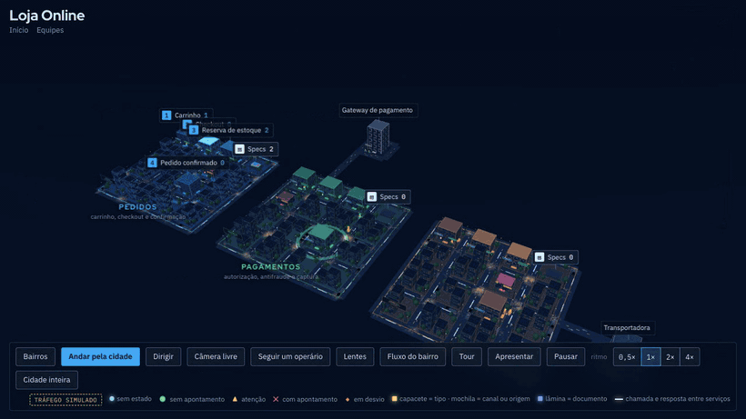
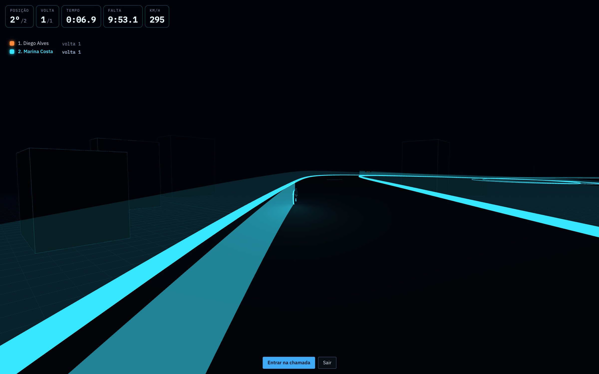
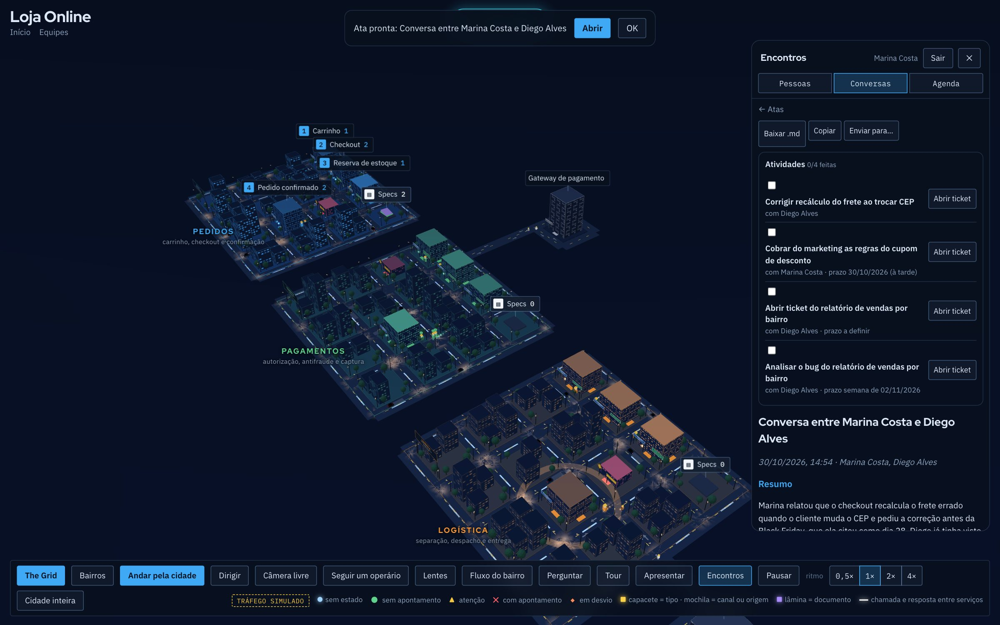
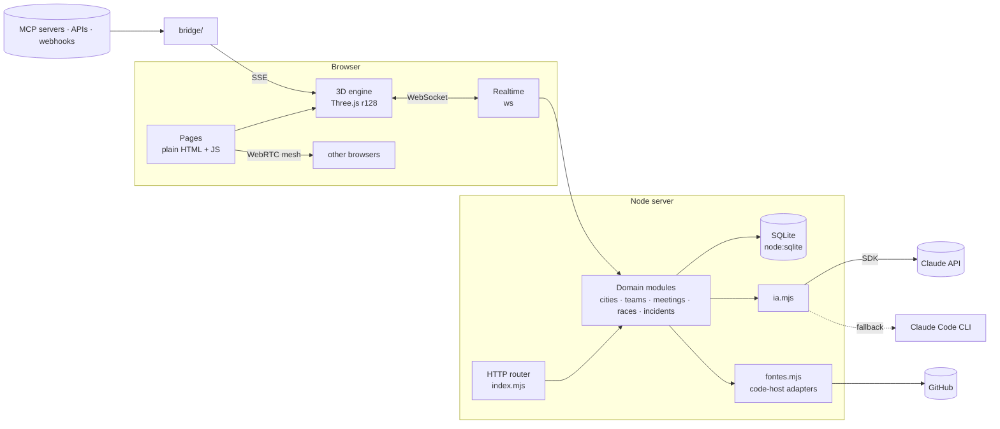

<div align="center">

# SystemCity · The Grid

**Your software architecture, as a living 3D city.**

Modules become districts. Flow steps become buildings. Every order, invoice or request walks the streets as a worker.
Your team meets, talks and runs the daily stand-up inside it, and races motorbikes on The Grid.

[](https://github.com/pedrocel/systemcity-thegrid/actions/workflows/testes.yml)
[](https://github.com/pedrocel/systemcity-thegrid/actions/workflows/codeql.yml)
[](LICENSE)


**[▶ Live demo](https://pedrocel.github.io/systemcity-thegrid/)** · [Português](README.pt-BR.md) · [Architecture](docs/ARCHITECTURE.md) · [Design decisions](docs/adr/)



</div>

## Why

Architecture diagrams go stale the day they are drawn, and nobody opens them during a meeting. SystemCity reads the repository, asks Claude to map it, and renders something people *want* to look at: a city where you can see which district is congested, which step is failing, and where the work agreed in yesterday's meeting is still under construction.

## What it does

| | |
|---|---|
| 🏙 **City from a repository** | Point it at a GitHub repo. The server reads the tree, manifests, READMEs and domain code, and Claude returns a typed city definition: districts, stations, detours, external systems and the folders each district owns. |
| 📡 **Live mode** | Plug the city into real HTTP APIs, SSE or WebSocket streams, webhooks and **MCP servers**. Queues grow buildings; failures send workers down red detours. |
| 🗣 **Meetings in the city** | Presence, chat, scheduling, WebRTC voice and video calls, live captions and an AI-written action list. Actions become construction sites in the district they affect until someone marks them done. |
| 🔥 **Incidents** | A building catches fire and opens a war room. When it is resolved, Claude writes the post-mortem. Alerts can come in by webhook (Sentry, Datadog…). |
| 🏁 **The Grid** | A multiplayer motorbike race for the daily stand-up, with voice chat in the corner, laps, scoring, seasons and achievements. Touch controls on mobile. |
| ⏪ **Replay & tour** | Rewind the last 48 h of queues and incidents; a guided tour and presentation mode with a script written by Claude. |
| 🔗 **Share & snapshot** | A read-only public link to the map, no account needed, and a one-click high-resolution photo of the city for docs and slides. |
| 🔎 **Ask the code** | RAG over the repository with local embeddings on CPU and answers cited by file and line. Retrieval is measured: recall@5 0.80, MRR 0.64 on 35 questions, and the numbers [overruled hybrid search](docs/adr/0008-busca-do-rag-pela-medida.md). |
| 💸 **AI cost tracking** | Every Claude call is attributed to a person and a kind of work, with an admin dashboard. |

<table>
<tr><td></td><td></td></tr>
<tr><td align="center"><sub>The Grid: the daily stand-up as a race</sub></td><td align="center"><sub>Meeting minutes with action items</sub></td></tr>
</table>

## Run it

```bash
git clone https://github.com/pedrocel/systemcity-thegrid.git && cd systemcity-thegrid
cp .env.example .env          # add your ANTHROPIC_API_KEY
docker compose up -d          # → http://localhost:3000
```

The image stays small (about 420 MB) because local embeddings for Ask the code are opt-in: `docker compose build --build-arg RAG_VETORES=1`.

Without Docker (Node ≥ 22.13): `cd servidor && npm install && npm start` → <http://localhost:4400>.
Without an API key, the server falls back to a local [Claude Code](https://claude.com/claude-code) install (`claude -p`).

Just the 3D engine, no server: `python3 -m http.server` and open `/cidade.html`.

## How it is built



A few choices worth reading about, each with its own ADR:

- **No build step on the front end.** Every page is plain HTML and ES2020; the engine is Three.js r128 vendored in the repo. Open the file, read the code, change it, refresh. → [ADR 0001](docs/adr/0001-frontend-sem-build.md)
- **The database is a file.** `node:sqlite` in WAL mode, with idempotent migrations that run at startup. One container, one volume, zero services to babysit. → [ADR 0002](docs/adr/0002-sqlite-embutido.md)
- **Two roads to Claude.** The official SDK in production; the local Claude Code CLI on a developer laptop, with the same interface. → [ADR 0003](docs/adr/0003-duas-vias-para-o-claude.md)
- **AI cost is attributed, not estimated.** `AsyncLocalStorage` carries *who* and *what kind of work* through every async hop, including background jobs a request starts. → [ADR 0004](docs/adr/0004-custo-de-ia-por-contexto.md)
- **Code hosts are adapters.** GitHub ships in the core; others register themselves. → [ADR 0005](docs/adr/0005-provedores-por-adaptador.md)
- **Open core by construction.** The paid edition is an optional layer the server loads only if it exists, not a pile of `if (paid)` flags. → [ADR 0006](docs/adr/0006-open-core.md)
- **Calls without a media server.** WebRTC mesh with signalling over the same WebSocket that carries presence. → [ADR 0007](docs/adr/0007-chamadas-webrtc-em-malha.md)

## Quality

- **Server tests** (`node --test`): accounts, sessions, rate limits, teams, meetings, live captions, races, incidents, replay, plans, signed webhooks. Real HTTP and WebSocket against an in-memory database, no mocks of our own code.
- **Browser tests** (Playwright): sign-up, teams, invites, the 3D city rendering, and the mobile layout without horizontal scroll.
- **CI** runs both on every push and pull request; **CodeQL** scans the JavaScript; **Dependabot** watches dependencies.
- **Security basics, done properly:** scrypt password hashing, `HttpOnly` + `SameSite` session cookies, CSRF guard (JSON-only writes + origin allow-list), constant-time checks on every webhook secret, per-IP and per-account rate limits, and a static file server that refuses anything outside the public tree.

## Project layout

```
*.html                 pages (no framework, no bundler)
engine/                3D engine and city modules (Three.js r128, vendored)
servidor/              Node server: one module per domain, routes in index.mjs
  testes/              server tests
e2e/                   Playwright tests
bridge/                MCP / HTTP / webhook → event stream
cities/                example city and ready-made templates
docs/                  guides, architecture and ADRs
```

The code and the UI are in Brazilian Portuguese: identifiers like `cidade` (city), `bairro` (district), `estação` (station), `operário` (worker). The [glossary in the architecture doc](docs/ARCHITECTURE.md#glossary) maps them.

## Contributing

Issues and pull requests are welcome, in English or Portuguese. Start with [CONTRIBUTING.md](CONTRIBUTING.md) and the issues labelled **good first issue**.

## Community edition and SystemCity Cloud

This repository is the open-source **community edition**. The hosted **SystemCity Cloud** adds AI code audits with agents, an agent that fixes code and opens pull requests, several repositories merged into one city with git history playback, Bitbucket and AWS CodeCommit, ticket integrations, local Whisper transcription, Google/Microsoft sign-in, managed AI and billing.

## Author

Designed and built by **Pedro Novais** · [github.com/pedrocel](https://github.com/pedrocel) · [LinkedIn](https://www.linkedin.com/in/pedro-novais-4113a915b/) · [pedronovaisengcp@gmail.com](mailto:pedronovaisengcp@gmail.com)

## License

[AGPL-3.0](LICENSE). Use it, study it, change it, host it. If you offer a modified version as a service, publish your changes under the same license.
