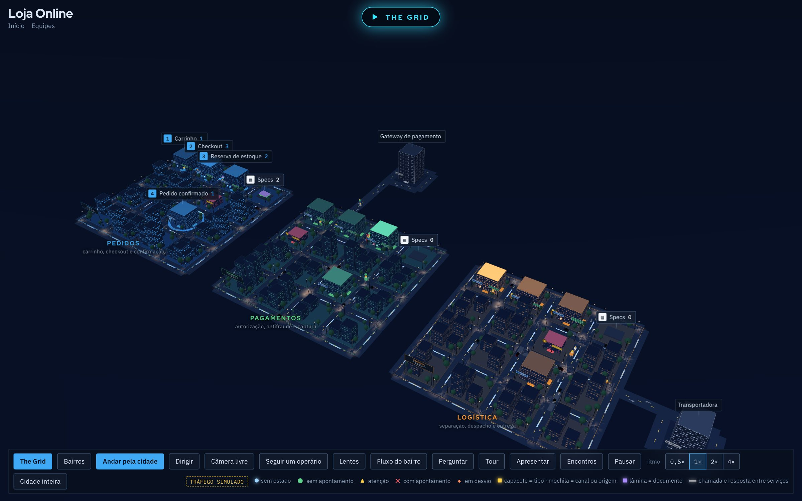

# SystemCity

**A arquitetura do seu software vira uma cidade 3D viva.** Conecte seus repositórios do GitHub, Bitbucket ou CodeCommit, e o Claude desenha a cidade: cada módulo é um bairro, cada etapa do fluxo é um prédio, e cada pedido, nota ou requisição é um operário andando pelas ruas. Agentes revisam o código atrás de falhas e acendem um farol no bairro com problema. O time se reúne, conversa e faz a daily dentro da cidade.

> **English:** SystemCity turns your software architecture into a living 3D city. Connect GitHub, Bitbucket or AWS CodeCommit repositories and Claude maps them into districts and buildings; AI agents audit the code and flag problem areas; your team meets, chats and runs stand-ups inside the city. The interface is in Brazilian Portuguese. Self-hosting instructions below; contributions in English or Portuguese are welcome.



## O que ele faz

- **Cidade gerada do repositório:** junte vários repositórios numa cidade só, com as ligações entre eles (quem chama quem) desenhadas pelo Claude.
- **Auditoria do código:** quatro agentes revisam segurança, bugs, desempenho e robustez. O achado vira um farol no bairro, e o agente de código prepara a correção e abre o Pull Request com você.
- **Linha do tempo do git:** toque a história do projeto e veja os bairros nascerem commit a commit.
- **Reuniões na cidade:** chat, chamadas de voz e vídeo, transcrição (no navegador ou com Whisper local) e ata com as atividades escrita pelo Claude. As atividades viram obras no bairro e tickets no GitHub Issues, no Jira ou no Linear.
- **Incidentes:** o prédio pega fogo, abre uma sala de guerra e, no fim, o Claude escreve o post-mortem.
- **The Grid:** uma corrida de moto multiplayer para a daily, com chamada de voz no canto da tela.
- **Ao vivo:** ligue a cidade nas suas APIs, webhooks e servidores MCP.
- **Custos de IA:** cada chamada ao Claude fica registrada por pessoa e por tipo, com um painel para o admin.

## Instalar

Você precisa de Docker e de uma chave da API da Anthropic (o SystemCity usa a sua chave: o custo da IA é seu, direto com a Anthropic).

```bash
git clone https://github.com/pedrocel/systemcity-community.git && cd systemcity-community
cp .env.example .env          # ponha a ANTHROPIC_API_KEY
docker compose up -d          # http://localhost:3000
```

Crie a sua conta na própria página, conecte o GitHub (ou outra conta) em **Projetos → Contas** e gere a primeira cidade.

Sem Docker, com Node 22.13 ou mais novo:

```bash
cd servidor && npm install && npm start    # http://localhost:4400
```

Sem a chave da API, o servidor usa o [Claude Code](https://claude.com/claude-code) instalado na máquina (`claude -p`), o que é prático para rodar no seu computador.

Para pôr na internet, deixe um proxy com HTTPS na frente (Caddy, Nginx, Traefik) e defina `SEGURO=1` e `ORIGENS=https://seu-dominio`. As câmeras e os microfones das chamadas só funcionam com HTTPS.

Todas as configurações estão em [.env.example](.env.example).

## Só a cidade, sem servidor

O motor 3D é uma página estática, sem build:

```bash
python3 -m http.server 4190    # http://localhost:4190/cidade.html
```

Para escrever uma cidade à mão, copie `cities/exemplo/` e siga [docs/CRIAR-CIDADE.md](docs/CRIAR-CIDADE.md).

## Documentação

| Assunto | Onde |
| --- | --- |
| Criar uma cidade à mão | [docs/CRIAR-CIDADE.md](docs/CRIAR-CIDADE.md) |
| Dados ao vivo (HTTP, SSE, webhooks, MCP) | [docs/CONECTORES.md](docs/CONECTORES.md) |
| Contas, conversas, reuniões e atas | [docs/ENCONTROS.md](docs/ENCONTROS.md) |
| Vários repositórios, linha do tempo e agente | [docs/UNIVERSO.md](docs/UNIVERSO.md) |
| Auditoria, IA, incidentes, conexões e custos | [docs/RECURSOS.md](docs/RECURSOS.md) |
| The Grid | [docs/THE-GRID.md](docs/THE-GRID.md) |

## Como o código está organizado

```
cidade.html, cidades.html, ...   as páginas (HTML e JS puros, sem build)
engine/                          o motor 3D (Three.js r128) e os módulos da cidade
servidor/                        Node: contas, equipes, cidades, IA, agentes, tempo real (WebSocket)
  testes/                        testes do servidor (node --test)
e2e/                             testes de navegador (Playwright)
bridge/                          MCP, APIs e webhooks → stream de eventos
cities/                          cidade de exemplo e modelos prontos
docs/                            a documentação
```

## Contribuir

Contribuições são muito bem-vindas: correções, novos conectores, novos provedores de código, traduções, melhorias no motor 3D. Leia o [CONTRIBUTING.md](CONTRIBUTING.md) antes de abrir o primeiro Pull Request, e procure as issues marcadas com **good first issue**.

## Licença

[AGPL-3.0](LICENSE). Você pode usar, estudar, modificar e hospedar o SystemCity. Se oferecer uma versão modificada como serviço para outras pessoas, publique o código das suas mudanças sob a mesma licença.
