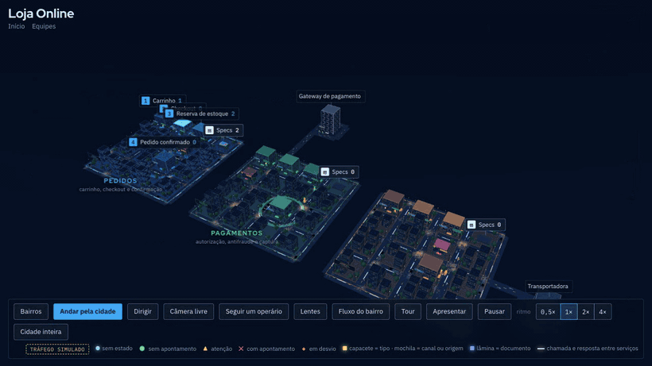
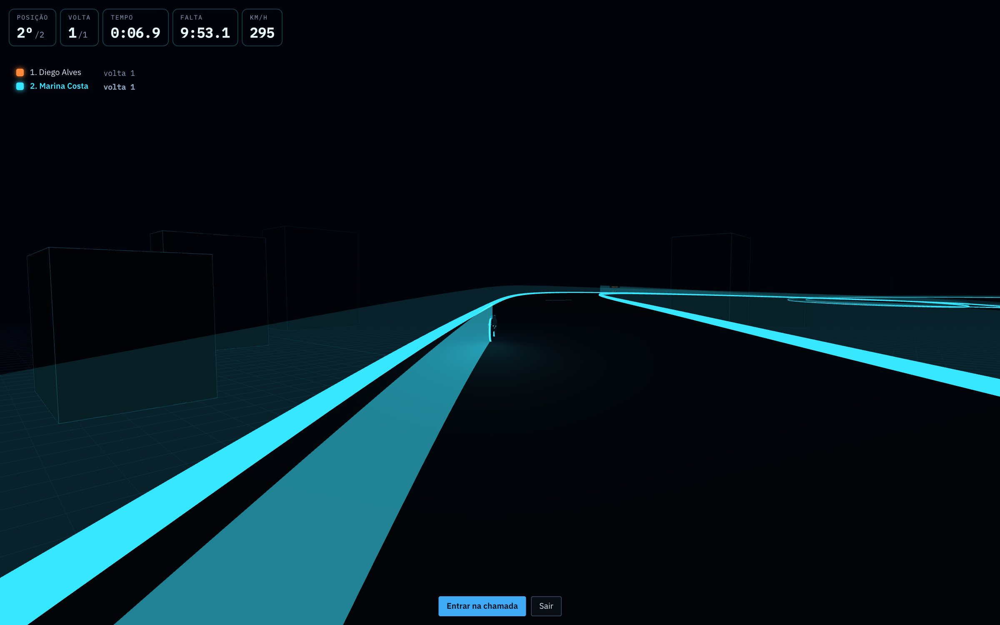
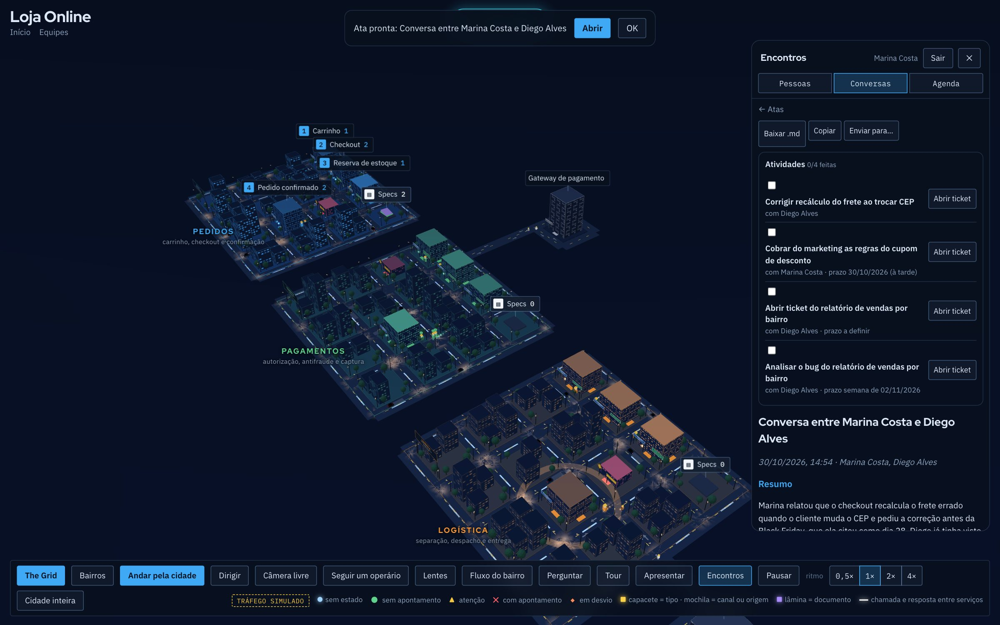

<div align="center">

# SystemCity · The Grid

**A arquitetura do seu software, como uma cidade 3D viva.**

Módulos viram bairros. Etapas do fluxo viram prédios. Cada pedido, nota ou requisição anda pelas ruas como um operário.
O time se reúne, conversa e faz a daily dentro dela, e corre de moto no The Grid.

**[▶ Demo ao vivo](https://pedrocel.github.io/systemcity-thegrid/)** · [English](README.md) · [Arquitetura](docs/ARCHITECTURE.md) · [Decisões técnicas](docs/adr/)



</div>

## Por quê

Diagrama de arquitetura fica velho no dia em que é desenhado, e ninguém abre durante a reunião. O SystemCity lê o repositório, pede ao Claude o mapa e desenha algo que as pessoas *querem* olhar: uma cidade onde dá para ver qual bairro está congestionado, qual etapa está falhando e onde a tarefa combinada na reunião de ontem ainda está em obra.

## O que ele faz

- **Cidade do repositório:** aponte para um repositório do GitHub. O servidor lê a árvore, os manifestos, os READMEs e o código de domínio, e o Claude devolve a definição da cidade: bairros, estações, desvios, sistemas de fora e as pastas de cada bairro.
- **Ao vivo:** ligue a cidade em APIs HTTP, streams SSE ou WebSocket, webhooks e **servidores MCP**. Fila cresce o prédio; falha manda o operário para o desvio vermelho.
- **Reuniões na cidade:** presença, chat, agenda, chamadas de voz e vídeo (WebRTC), legenda ao vivo e a ata com as atividades escrita pelo Claude. As atividades viram obras no bairro até alguém marcar como feitas.
- **Incidentes:** o prédio pega fogo e abre uma sala de guerra. Resolvido, o Claude escreve o post-mortem. Alertas também chegam por webhook (Sentry, Datadog…).
- **The Grid:** corrida de moto multiplayer para a daily, com chamada de voz no canto, voltas, pontuação, temporadas e conquistas. Controles de toque no celular.
- **Replay e tour:** volte as últimas 48 h de filas e incidentes; tour guiado e modo apresentação com roteiro do Claude.
- **Link público e foto:** um link só de leitura para qualquer pessoa ver o mapa sem conta, e uma foto da cidade em alta resolução com um clique.
- **Custo de IA:** cada chamada ao Claude é atribuída a uma pessoa e a um tipo de trabalho, com painel para o admin.

<table>
<tr><td></td><td></td></tr>
<tr><td align="center"><sub>The Grid: a daily como corrida</sub></td><td align="center"><sub>A ata com as atividades</sub></td></tr>
</table>

## Rodar

```bash
git clone https://github.com/pedrocel/systemcity-thegrid.git && cd systemcity-thegrid
cp .env.example .env          # ponha a ANTHROPIC_API_KEY
docker compose up -d          # → http://localhost:3000
```

Sem Docker (Node ≥ 22.13): `cd servidor && npm install && npm start` → <http://localhost:4400>. Sem chave da API, o servidor usa o [Claude Code](https://claude.com/claude-code) instalado (`claude -p`). Só o motor 3D, sem servidor: `python3 -m http.server` e abra `/cidade.html`.

## Como é feito

A [arquitetura](docs/ARCHITECTURE.md) explica as peças, e cada decisão importante tem um registro em [docs/adr/](docs/adr/):

- front **sem build** (HTML e JS puros, Three.js r128 no repositório);
- **SQLite do próprio Node** num arquivo, com migrações idempotentes;
- **duas vias para o Claude**: o SDK em produção e o Claude Code no notebook;
- **custo de IA atribuído por contexto** (`AsyncLocalStorage`), inclusive no trabalho em segundo plano;
- **provedores de código por adaptador**;
- **open core por construção**: a edição paga é uma camada opcional, não um monte de `if (pago)`;
- **chamadas WebRTC em malha**, com a sinalização no mesmo WebSocket da presença.

## Qualidade

Testes do servidor (`node --test`) com HTTP e WebSocket de verdade contra banco em memória, testes de navegador com Playwright (incluindo o layout no celular), CI em todo push e Pull Request, CodeQL e Dependabot. Senha com scrypt, cookie `HttpOnly` + `SameSite`, proteção contra CSRF, comparação em tempo constante dos segredos de webhook, limites por IP e por conta, e um servidor de arquivos que recusa o que está fora da parte pública.

## Contribuir

Issues e Pull Requests são bem-vindos, em português ou inglês. Comece pelo [CONTRIBUTING.md](CONTRIBUTING.md) e pelas issues **good first issue**.

## Edição da comunidade e SystemCity Cloud

Este repositório é a **edição da comunidade**, de código aberto. O **SystemCity Cloud**, hospedado, soma auditoria do código com agentes, o agente que corrige e abre Pull Request, vários repositórios numa cidade só com a linha do tempo do git, Bitbucket e AWS CodeCommit, integração com tickets, transcrição com Whisper local, login com Google e Microsoft, IA inclusa e cobrança.

## Autor

Criado por **Pedro Novais** · [github.com/pedrocel](https://github.com/pedrocel) · [LinkedIn](https://www.linkedin.com/in/pedro-novais-4113a915b/) · [pedronovaisengcp@gmail.com](mailto:pedronovaisengcp@gmail.com)

## Licença

[AGPL-3.0](LICENSE).
