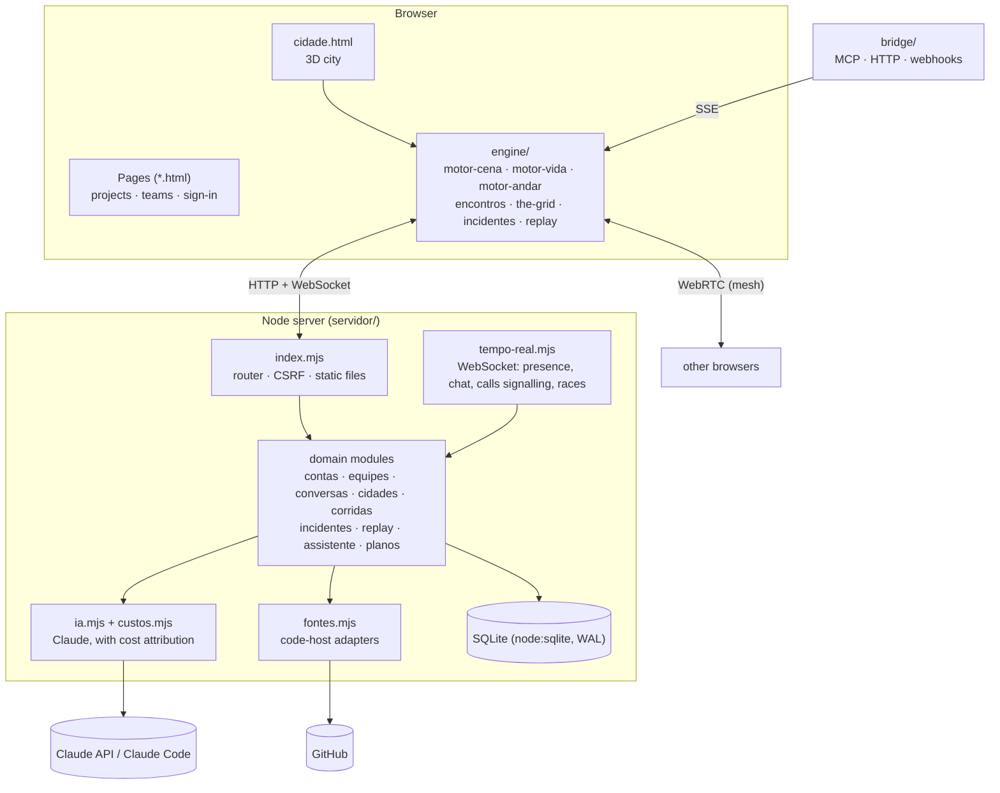
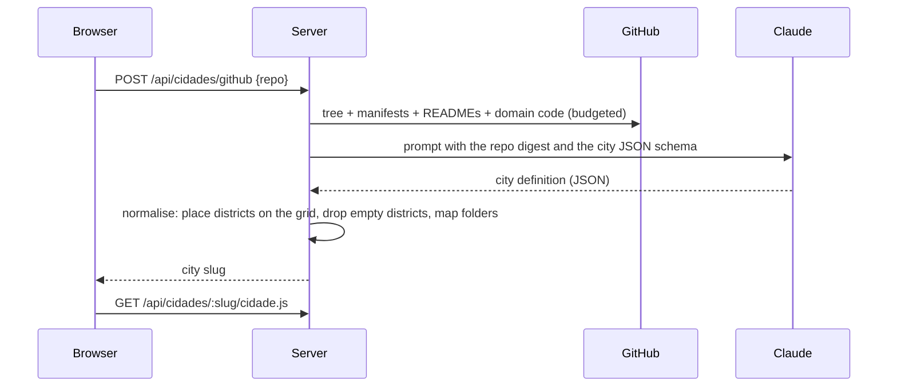

# Architecture

SystemCity is one Node process and a set of static pages. There is no front-end build, no separate database server and no message broker: the whole thing runs from one container with one volume.

## The pieces

### Front end

- **No bundler, no framework.** Each page is HTML with a `<script>`; the engine is a set of IIFEs that share one object, `window.CID`. Three.js r128 is vendored under `engine/vendor/`.
- **The city is data.** A city is a single object (`SystemCity.definir({...})`): districts with a grid footprint, stations, detours, routes and external systems. `engine/cidade.js` completes and validates it; the engines only read it. The same format comes from a hand-written file, a template, or Claude.
- **Engines are layered:** `motor-cena` builds the world, `motor-vida` runs the simulation, camera and labels, `motor-andar` walks and drives, and feature modules (`encontros`, `the-grid`, `incidentes`, `replay`, `tour`…) attach to the shared object without knowing about each other.

### Server

- **One module per domain.** Each exports a factory that receives the database and the other modules it needs, and returns plain functions. No classes, no DI container.
- **`index.mjs` is the router.** Routes are explicit `METHOD /path` checks, in one place, so the whole API surface can be read top to bottom.
- **Errors meant for people** are `ErroUso(message, status)`; anything else is logged and becomes a 500 with no details leaked.
- **Realtime** (`tempo-real.mjs`) is one WebSocket per tab carrying presence, chat, call signalling, captions and race state. Rooms are the unit of delivery.

### Generating a city from a repository

The reader spends a fixed budget (files and bytes) and scores paths so that manifests and domain folders win over tests and generated code. The answer is validated and normalised, never trusted: unknown ids are dropped, districts are laid out on the grid by the server.

### AI cost attribution

Every request runs inside an `AsyncLocalStorage` context holding the user and the kind of work (`cidade`, `ata`, `pergunta`, `incidente`…). `ia.mjs` records tokens and cost after each Claude call, reading that context. Background work started by a request inherits it, so a job that finishes minutes later is still charged to the right person. Through the API the cost is computed from tokens; through the local Claude Code CLI it comes from the CLI itself.

### Open core

`index.mjs` loads `servidor/cloud/index.mjs` only if the folder exists. The Cloud layer receives a small context from the core (database, modules, response helpers) and contributes routes, a feature list (`/api/eu → recursos`) and hooks such as "a city was generated". Pages ask the server which features exist and adapt. The community edition is the same core with that folder absent: no flags to flip, nothing hidden to unlock.

## Security model

| Concern | How |
|---|---|
| Passwords | scrypt with a per-user salt |
| Sessions | random token in an `HttpOnly`, `SameSite=Lax` cookie (`Secure` behind HTTPS) |
| CSRF | writes must be `application/json`; with `ORIGENS` set, the `Origin` must match |
| Webhooks | shared secrets compared in constant time; GitHub pushes verified with HMAC-SHA256 |
| Abuse | per-IP and per-account rate limits on sign-up, sign-in, password reset and AI calls |
| Static files | only the public tree is served; `servidor/`, `bridge/`, dotfiles and `node_modules` are refused |
| Visibility | cities, rooms and teams are checked against membership on every read |

## Glossary

The code is written in Brazilian Portuguese. The words that matter:

| Code | Meaning |
|---|---|
| `cidade` | city: the whole map of one system |
| `bairro` | district: a module or bounded context |
| `estação` / `prédio` | station / building: a step in a district's flow |
| `desvio` | detour: an error or alternative path |
| `operário` | worker: an item travelling through the system |
| `externo` | external system (payment gateway, carrier…) |
| `encontros` | meetings: presence, chat, calls, agenda |
| `ata` | meeting minutes; `atividade` is an action item |
| `obra` | construction site: an open action item shown in its district |
| `corrida` | race (The Grid) |
| `equipe` | team |
| `fonte` | source of a city (`github:owner/repo`, `modelo:saas`…) |
